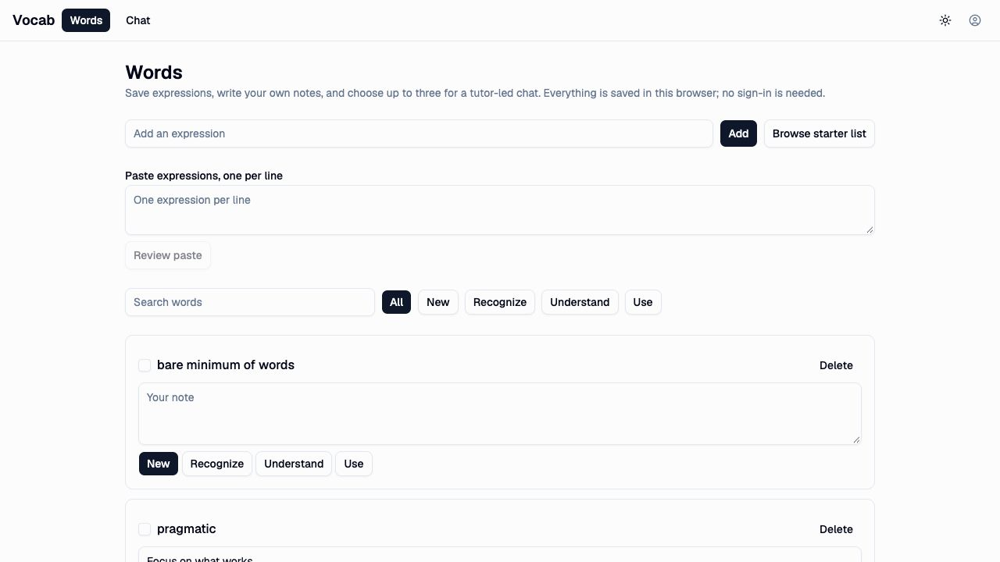

# Local folder acceptance, 2026-10-03 (historical milestone)

This record covers the earlier IndexedDB implementation. Current OPFS and
canonical-editor acceptance is recorded in
[the folder acceptance report](../../../packages/folder/evidence/opfs/ACCEPTANCE.md).
The legacy-account import it describes was removed in the OPFS clean break
([review](opfs-clean-break-review.md)).

The user explicitly requested `@epicenter/folder/browser`, local use before
login, and optional login later. English vocabulary and English instruction
remain the intended use case. This replaces the earlier account-bound word
storage requirement; Local Mail's named-query sync requirement is unchanged.

## Actual browser journey



Codex exercised the live Vocab at `http://localhost:8888/` through the in-app
browser, signed out, using the integrated Opus 5.5 migration. Data was created
through the normal UI; no synthetic store or scripted tutor supplied it.

1. Words opened without login. Added `laconic` and `pragmatic`.
2. Saved a note for `laconic`, chose Understand, and reloaded. Both words,
   the note, and stage returned.
3. Chose both words and started a chat. Connected the running local Ollama
   through the model picker's Ollama preset, selecting `qwen3.5:9b`.
4. Requested the opening and received a real English tutor response.
   Reopened its saved transcript and sent a follow-up asking for a short
   example of `laconic` and its tone. The follow-up completed.
5. Used the completed answer's Save a phrase control to save
   `bare minimum of words`. The UI confirmed the save. After reload, Words
   showed the phrase with an empty note and New stage beside the original words.
6. Typed a draft in the first tab while a second tab saved a different note
   for `laconic`. Leaving the first field retained the draft, displayed the
   saved note, and offered an explicit conflict choice. Save mine instead
   completed and dismissed the conflict. The second test tab was closed.

During this shared-checkout run the page was replaced once between tutor
completion and composer input. Reopening Chat restored the stored opening and
the device's selected Ollama endpoint. That observation proves transcript and
endpoint retention; it does not establish the cause of the page replacement.

## Review evidence

Files read in their caller context:

```text
apps/
|-- README.md
`-- vocab/
    |-- README.md
    |-- package.json
    |-- vite.config.ts
    `-- src/
        |-- lib/
        |   |-- data.ts and data.test.ts
        |   |-- folder.ts and folder.test-support.ts
        |   |-- entries.svelte.ts and entries.test.ts
        |   |-- inference.ts and inference.test.ts
        |   |-- reread.ts and reread.test.ts
        |   |-- note-draft.svelte.ts
        |   |-- legacy-import.ts and legacy-import.test.ts
        |   |-- legacy-source.ts
        |   `-- chat/
        |       |-- chats.svelte.ts
        |       |-- messages.ts and messages.test.ts
        |       `-- session.svelte.ts
        `-- routes/
            |-- +page.svelte
            `-- components/
                |-- VocabShell.svelte
                |-- EntryCard.svelte
                |-- LegacyImport.svelte
                |-- FocusWords.svelte
                `-- PhraseCapture.svelte
packages/app/src/product-startup.test.ts (scoped change)
README.md and BACKLOG.md (Vocab scope)
bun.lock (Vocab hunk)
```

The folder owns file receipts and conditional writes. Entries owns the saved
word list and per-word admission. The selected conversation owns its transient
draft and loop. Auth owns hosted access, not the saved learning data. Old-store
import is an explicit boundary, not another normal write path.

Independent GPT-6.1 and Opus reviews found collision handling for dependent
imported rows, stale duplicate acknowledgement, reread races, and a note's own
successful-save baseline. Corrections remain within these owners; they do not
restore Personal writes or the login gate. Cloud-wide legacy discovery was
left separate: the import explicitly copies this browser's held rows.

After correction, Codex re-exercised duplicate phrase acknowledgement against
the actual folder, edited a note through the new draft owner, repeated a
two-tab conflict, chose Keep the saved note, and reloaded. The stored real tutor
transcript and local model selection returned through the final implementation.

## Final automated checks

Codex reproduced 146 passing tests with 673 assertions across 20 files:
`bun test apps/vocab/src/lib packages/agent/src packages/client/src packages/app/src/product-startup.test.ts`.
Vocab typecheck had zero errors and warnings; production build succeeded.
The UI boundary, boot purity, and diff checks passed. The tests include
dependent import refusal and retry, delayed rereads, deleted cached duplicates,
rapid own-note saves, queued-blur conflict refusal, and Unicode message storage.

## Limits

The current browser adapter uses IndexedDB. No physical `local/` directory or
native Vocab distribution was created. No remote sync was configured. Real
legacy-account import, hosted inference, touch selection, dictation, and browser
storage eviction were not exercised. Earlier stores remain intact.
