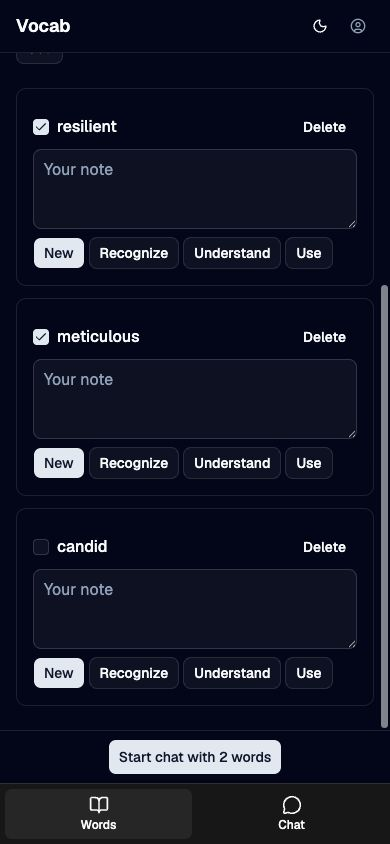
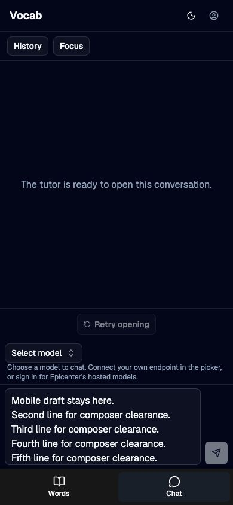

# Mobile navigation verification

2026-10-04. Source baseline: 293dccb4dba81bcdbbf06d43fe5ee17e6e0e6ae2, including the concurrent Vocab Result changes present in the checkout. The UI patch changes VocabShell and WordsView; storage, chat generation, and auth logic are unchanged. The production preview at http://127.0.0.1:5263 served build 1791086844100.

The disposable browser folder held candid, meticulous, resilient, and chats started through the UI. No model was connected and no inference request was sent.

## Browser observations

- Words and Chat fit 320, 390, 767, and 768px widths without horizontal overflow. Navigation sits below content under 768px and in the header from 768px.
- At 390x844, the mobile bar is 61px tall with 52px button targets. The selected Words action ends at y775, above navigation at y783. The final word remains visible at the scroll end.
- A six-line chat draft survives Words to Chat and back. Returning to the selected chat does not open History. The composer ends at y777, above navigation at y783.
- Hiding and reopening Add multiple retains pasted text and a deselected review choice. Starter-list review choices remain independent and survive the same toggle.
- Starting a chat with two selected words preserves both focus terms. The static preview runs these checks without hot reloads resetting drafts.

## Command checks and limits

Coordinator verification: 97 domain tests pass, typecheck has zero errors and warnings, and the production build passes. Claude returned a two-file patch but could not run typecheck in its sandbox because prepared dependency links were unreadable there; those checks were performed in the live checkout.

Development-server reloads during SvelteKit generation interrupted initial checks. Final acceptance used the stable static preview. Physical phone keyboard, device safe-area behavior, touch, hosted sign-in, and live tutor streaming were not tested in this layout wave.

## Boundary review

One navigation element is positioned by CSS; there is no breakpoint state or navigation component. The shell reserves navigation space. Words owns a scroll region and a separate selected-action footer, replacing the floating button and its clearance padding. The selected ConversationView remains mounted across view switches, preserving its existing draft and reply lifetime. Add multiple controls visibility only; paste and review state remain in WordsView. File organization and public signatures remain unchanged.
