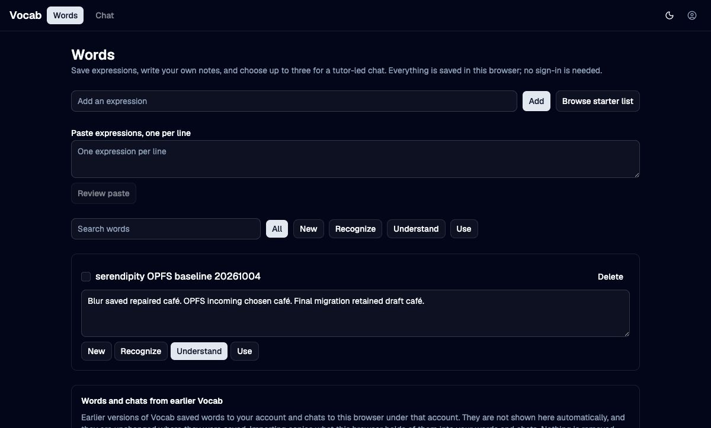

# OPFS migration acceptance

Date: 2026-10-04

The candidate started from branch commit `401708bb48` with only the Vocab and
Whispering migration paths and Vocab workspace lock entry. Chrome exercised
Vocab at `http://localhost:5232` from the clean candidate checkout.

The existing fixture expression remained available. Editing its note and
blurring saved it; reload restored that note. A second tab then saved a
replacement while the first tab held an unsaved note. The first tab retained
its draft and offered an explicit choice. Choosing Save mine instead published
the retained draft, and another reload restored it.

The migration uses one release Local OPFS folder. The stable app ID preserves
its address; the shared opener copies an earlier IndexedDB folder on first
open. These journeys exercised the existing OPFS fixture, not a real legacy
account import. No model request or account sign-in occurred.

Coordinator checks on the clean candidate passed: frozen dependency install,
105 tests with 677 assertions, typecheck without errors or warnings, and a
static production build. The final review removed unused exports and direct
dependencies and repeated the frozen install, focused editor tests, full Vocab
suite, typecheck, and build.
The legacy import failure list now permits the same row ID in different tables
without duplicate UI keys. A real legacy account import remains unverified.

