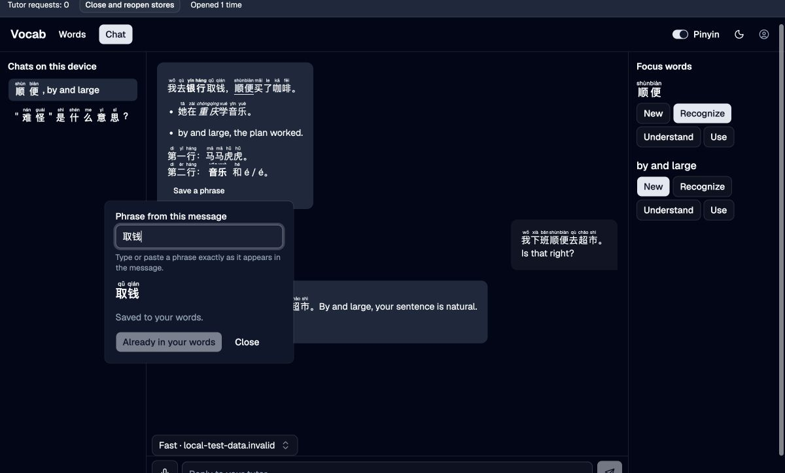

# Reading and phrase capture verification

On 2026-10-03 the actual Vocab components were exercised in Chrome over
synthetic memory stores and a scripted tutor. The fixture mounted `VocabShell`
and its production descendants. It used no live account or inference service.
Its source remains in the task artifact at
`/private/tmp/epicenter-vocab-publication-20261002/apps/vocab/.task-harness/`.
The temporary copy in the shared checkout was removed and its server stopped.

Observed behavior:

- Pinyin appears across words, notes, chat titles, focus, and completed messages.
  Banks and music receive contextual readings across Markdown formatting.
- The preference survives closing and reopening the fixture's stores.
- Pointer selection offers base Chinese text. Copying that selection yields
  `行`, with no reading appended.
- The per-message capture button focuses an exact-phrase field. Enter saves
  `取钱`; an already stored phrase shows duplicate feedback.
- Refused Personal storage shows failure and permits saving again. The same
  phrase is stored once when storage recovers.
- Refused Local storage keeps the learner's draft, makes zero tutor requests,
  disables capture, and guards switching chats.
- Stop restores retry controls. A truncated scripted answer shows an output
  limit error and is not published as a finished answer.
- At 320 and 375 pixels, the header controls remain reachable and document
  width equals viewport width. The controls wrap at narrow widths.

Verification in the shared checkout passed 138 focused tests with 616 assertions
across the agent, client, Vocab, Home host, and AI tests. Vocab typecheck reported
zero errors and warnings; production build, UI boundary check, and diff check
passed. The reliability-only first-wave snapshot independently passed 122 tests
and Vocab typecheck. The supervisor independently passed the 16 reading and
entry tests with 158 assertions.

These checks do not establish real-provider behavior, touch selection, or
second-device synchronization. A phrase's saved state confirms this device's
Personal storage; it does not confirm account synchronization. English tutoring
remains unchanged while language intent is pending.

Local Mail's saved-query synchronization also remains unverified across real
devices. The pending user action is to make a second device signed into the same
Epicenter account accessible, or perform the remote step: save a named query,
report its name and SQL, and confirm a subsequent edit from this Mac there.
Mailbox synchronization and SQL execution are not needed for that check.
