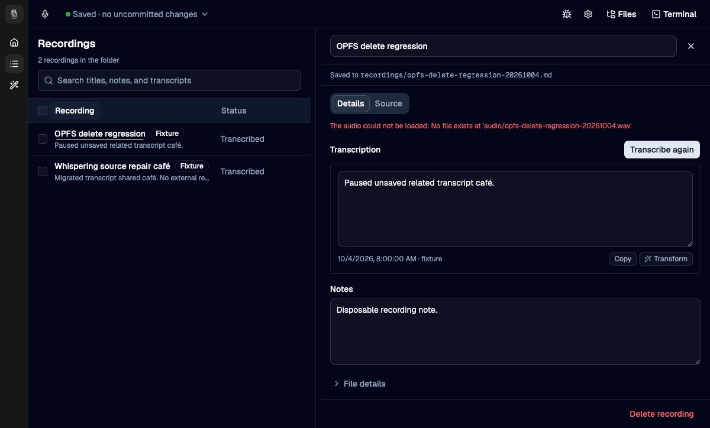
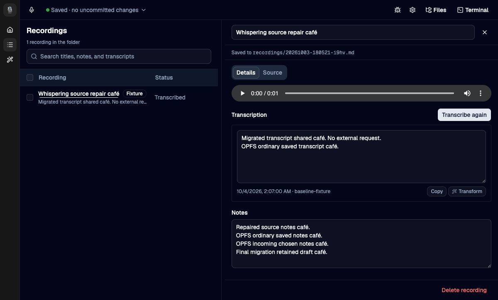
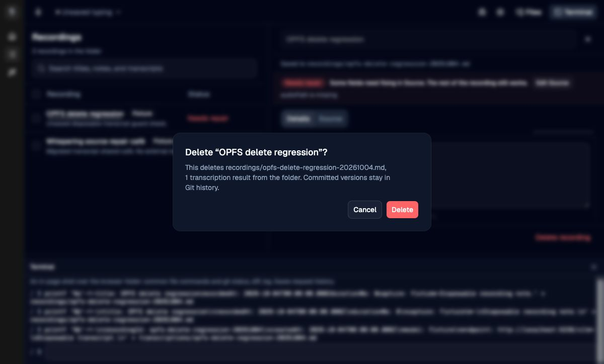

# OPFS migration acceptance

Date: 2026-10-04

The candidate started from branch commit `401708bb48` with only the Vocab and
Whispering migration paths and Vocab workspace lock entry. Chrome exercised
Whispering at `http://localhost:5235` from the clean candidate checkout.

Clean break, recorded after this run: the browser opener no longer copies a
folder an earlier build kept in IndexedDB, and Whispering no longer has an
IndexedDB-specific refusal. Earlier IndexedDB folders are not read. This
record does not say whether its fixture first reached OPFS through that copy,
and the clean break has not been exercised in a browser. Device settings in
`localStorage` and an earlier build's key are unaffected.

Notes autosaved, settled to Saved, and survived reload. Exact source editing
saved an invalid duration value and visibly showed Needs repair. Correcting
the duration to 1000 restored structured fields while preserving the fixture's
unknown owner metadata and audio path.

With automatic saving paused, a local draft stayed intact while a second tab
saved another version. Save mine over it explicitly published the retained
draft; reload restored it. Automatic saving was then enabled again. The
migrated one-second audio fixture changed from Play to Pause and back to Play.

Coordinator checks on the final clean candidate passed: 444 tests with 3229
assertions, Svelte and native TypeScript checks, and a static production build.
Cumulative review removed unused exports and an unused deletion method. It also
closed a deletion window by retiring related result drafts before deleting a
recording, and prevents overlapping path commands from releasing each other's
fences. Failing-before/passing-after regressions cover dirty and unknown result
drafts, both rename/deletion orders, move destinations, and a debug obstacle
counter overlap. These deletion races are automated evidence; the browser
journeys above do not establish their timing.

A final adjacent journey created a new recording and related transcript through
the app's Terminal. With automatic saving paused, typing in the transcript
remained visible when the parent deletion confirmation opened. The journey
cancelled the confirmation, used Save now, restored automatic saving, and
reloaded. Both files and the saved transcript survived. The fixture references
its own absent audio path; no microphone or existing audio was touched.
The app offers permanent deletion, so the browser journey did not press its
final Delete action. The actual refusal and race remain automated evidence.

This is browser evidence using fixtures. No microphone, transcription, model,
or account request occurred. The installed native app was readable, but the
candidate native GUI was not exercised by these journeys.

