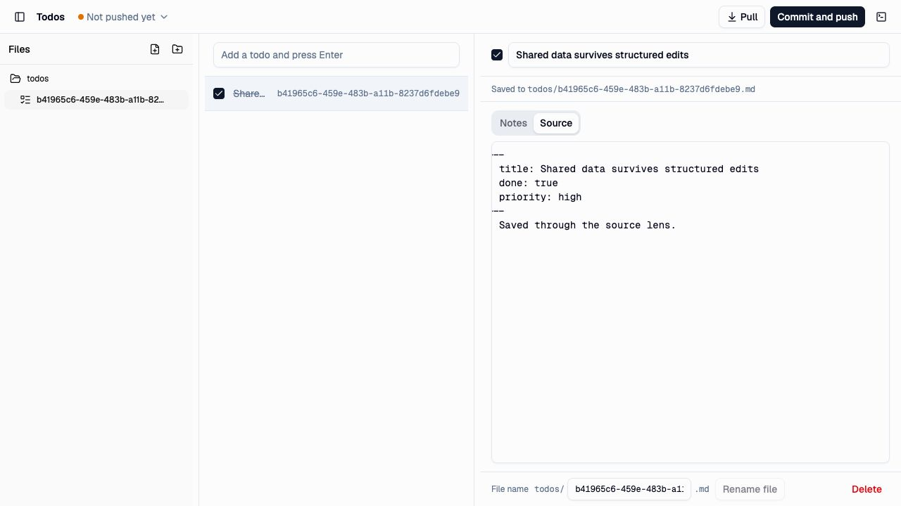

# Dataset address journey

Date: 2026-10-03. Source baseline: `1e3101d842e6b100af2298a3d0771cc3bb57cbe5`
with the live checkout's existing Folder and Todos changes. This pass changed
documentation only. It exercised the browser Todos app with
`bun dev:todos:ui --port 5259` at `http://127.0.0.1:5259/` in the Codex in-app
browser. The fresh origin held only synthetic data from this journey.

## Observed journey

1. Created “Verify shared folder address” through the todo title input. The
   file tree and detail view named the same `todos/<stem>.md` file.
2. Opened Source. Added `priority: high` and the body “Saved through the source
   lens.” Waited for the saved indication.
3. Changed the structured title to “Shared data survives structured edits”.
   Source retained the undeclared priority field and body.
4. Opened a second tab at the same origin. It read the saved title and body.
5. Marked the todo done in the second tab. The first tab reflected `done: true`
   while retaining the other source text.
6. Reloaded the second tab and reopened Source. Title, completion, priority,
   and body remained saved. The screenshot captures this final view.

## Decision and limits

Keep `definition.id` as the default dataset name and the opening `id` override
for another dataset. A definition interprets files; its ID does not prove a
schema or establish exclusive app ownership. Keep the captured address separate
from private SQL namespaces. No failure in this journey justified a new schema
identity layer, registry, folder picker, or opening API.

The UI demonstrated source preservation, same-origin reopening, and change
notification across tabs. It did not demonstrate two different applications,
multiple folder IDs, account switching, native filesystem layout, OPFS SQL, or
cloud transfer. No push or pull was attempted; this frontend-only instance did
not establish a disposable Git backend.

Separately, `bun test packages/folder/src/browser-scope.test.ts` passed all six
tests, including account/channel separation and captured account identity.
These are automated checks, not UI evidence. Application account startup and a
multi-dataset selection journey need their own acceptance when implemented.
