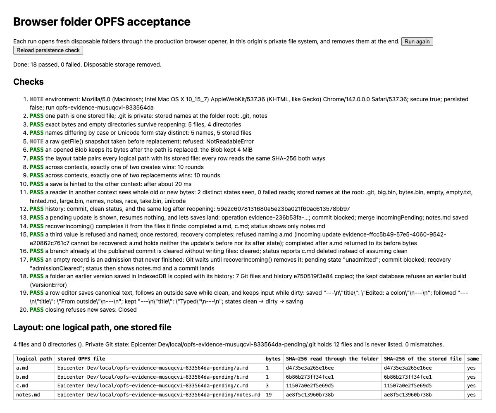
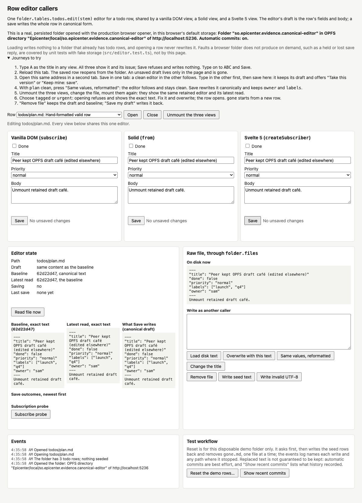
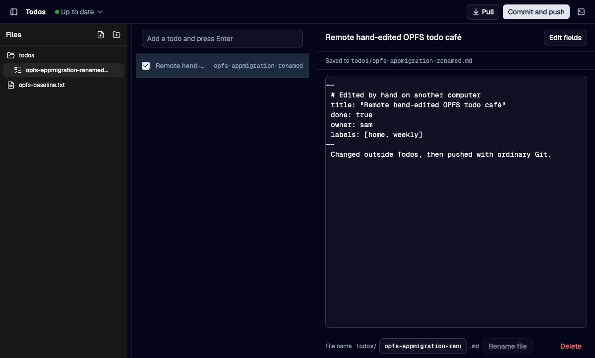
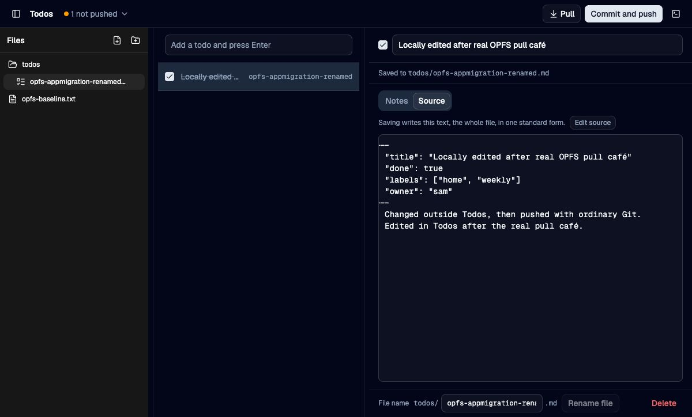
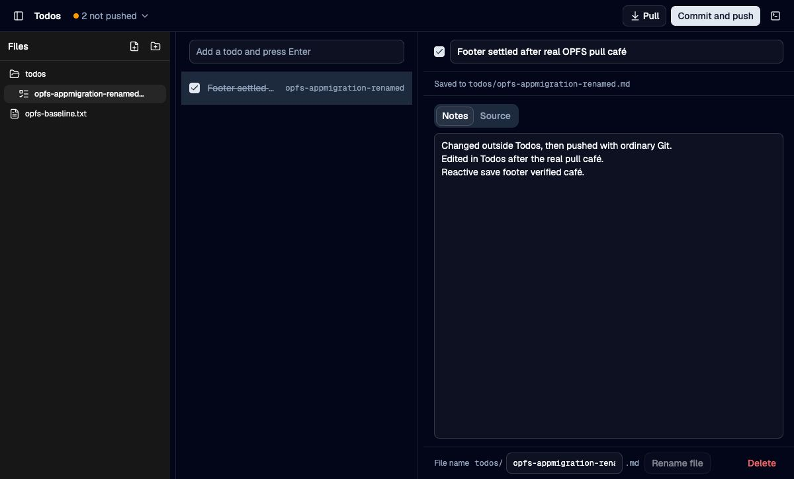

# OPFS and canonical editor acceptance

Verified on 2026-10-04 against the integrated OPFS and native protocol 5 source. Browser evidence uses Chrome 142 on macOS, secure localhost origins, and the production browser opener. Browser persistence permission was not granted (`persisted: false`).

## Working demos

From the repository root:

```sh
bun packages/folder/evidence/opfs/serve.ts
bun packages/folder/evidence/edit-handle/canonical-dev.ts
```

The OPFS page passed all 18 checks twice. Its separate reload check passed. It compares each logical file with the physical scoped OPFS file by hash, excludes private `.git` files from listings, and exercises independent contexts, bytes, empty directories, history, legacy IndexedDB migration, interrupted incoming updates, third-state refusal, explicit recovery, and canonical editing. Each run uses and removes its own disposable folders. A raw `getFile()` snapshot became unreadable after replacement in this browser; the opened Blob retained its bytes.



The canonical page shares one production RowEditor among Vanilla, Solid, and Svelte callers. Actual use verified shared typing, invalid-field refusal, canonical save and reload, preservation of undeclared `owner` and `labels`, incoming changes held while dirty, explicit keep/adopt, and retained editing across view unmount/remount.



## Application journeys

All five consumers opened their existing datasets at retained localhost origins after cutover: Capture, Vocab, Honeycrisp, Todos, and Whispering. Ordinary saves persisted through reload. Each exposed and resolved an incoming or exact-source choice without discarding the held draft implicitly. Whispering also retained the matching audio file and transcript; actual playback reached one second. No microphone or model request was exercised.

Todos additionally committed and pushed its disposable local history, pulled a file edited with ordinary native Git, and displayed its incoming comment, title, done state, `owner`, and `labels` byte for byte. A subsequent structured edit saved canonical YAML, preserving unknown metadata and normalizing the comment away. Reload retained that save. A subsequent status repair was rechecked in the same mounted editor: the footer changed from unsaved typing to saved, and reload retained the bytes. The fixture is `scripts/remote-edit.ts <native-checkout> <stem> [title]` under `apps/todos`.







## Automated verification

The integrated folder suite passed 685 tests with 18 opt-in native tests skipped, with a clean TypeScript check. The actual invoke bridge separately passed 18 tests and 100 assertions. Native recovery and owner tests passed 95 core tests and 20 plugin tests; one unrelated opt-in test was ignored. Honeycrisp passed 59 Rust tests and 25 native close-lifecycle tests. Whispering passed 14 Rust tests.

Application suites passed: Capture 84, Vocab 105, Honeycrisp 263, Todos 121, and Whispering 437. Their TypeScript checks and browser builds passed. Todos and Whispering host builds also passed.

Fault-injected production storage and editor tests cover lost replies and interrupted incoming updates. These are automated evidence, not a claim that the app UI can manufacture a storage failure.

## Limits

Native desktop UI acceptance remains open while the macOS session is locked. Headless native verification does not substitute for that journey. These checks establish process interruption behavior, not physical power-loss durability. External writers can still change a file after a final read; canonical saves deliberately overwrite the whole document. Browser storage remains subject to origin quota and browser retention policy.
