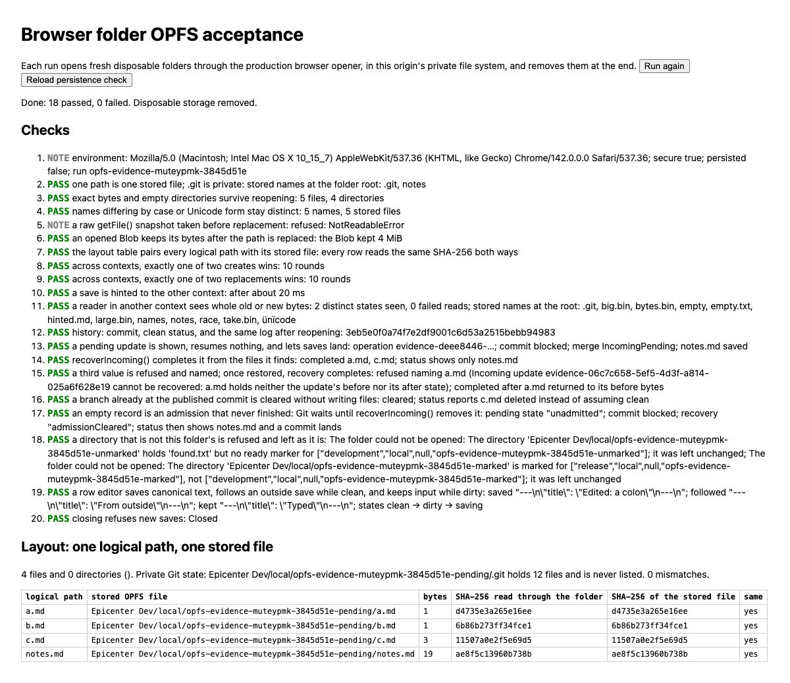
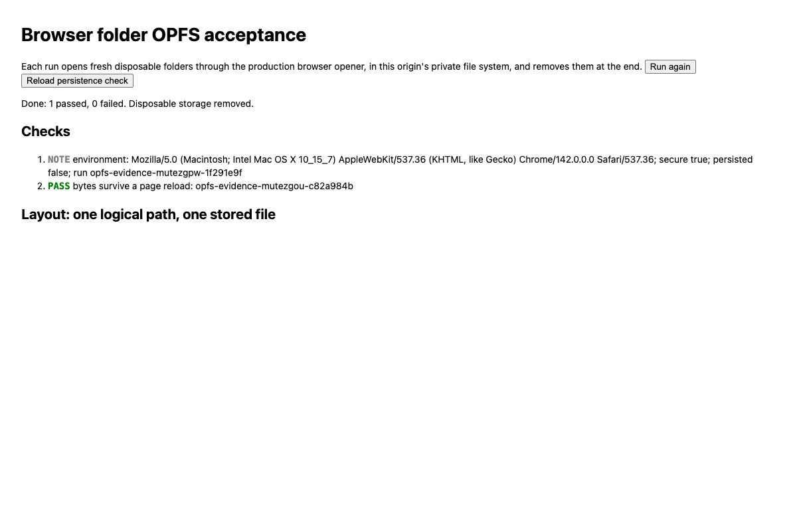
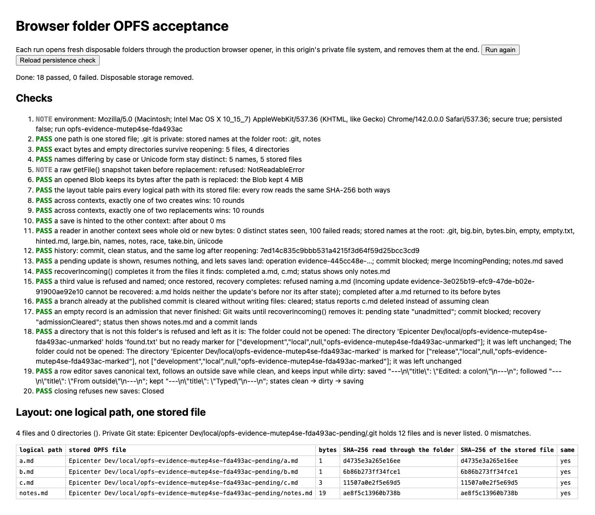
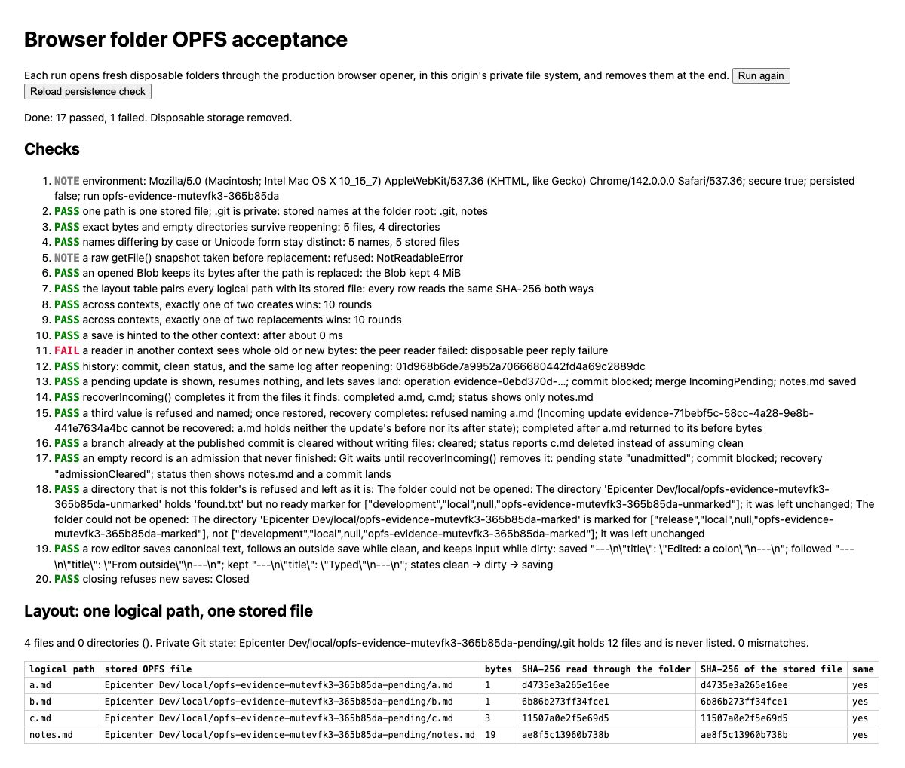

# OPFS bounded correctness wave

Verified by Codex on 2026-10-04. This wave repairs three findings from the cutover review. It does not change the storage engine, durable layout, public API, or native owner.

## Files read before local analysis

This inventory covers the bounded wave's source inspection, supporting instructions, and evidence. Full source reads of all five touched TypeScript files were repeated after the candidate edits; the integrated bytes match those reviewed. Excerpts and extracted metadata are marked explicitly. The independent reviewers retain their own exact inventories in their linked reports.

```text
Epicenter/
|-- AGENTS.md                                             [user supplied]
|-- .agents/skills/
|   |-- adversarial-review/SKILL.md                       [full]
|   |-- computer-use-driven-iteration/SKILL.md             [full]
|   |-- consult-claude/
|   |   |-- SKILL.md                                      [full]
|   |   `-- scripts/consult-claude.ts                      [full]
|   |-- delegate-claude/SKILL.md                           [full]
|   |-- post-implementation-review/SKILL.md                [full]
|   |-- testing/SKILL.md                                  [full]
|   |-- git/SKILL.md                                      [full]
|   |-- standalone-commits/SKILL.md                       [full]
|   `-- monorepo/SKILL.md                                 [full]
`-- packages/folder/
    |-- README.md                                         [orientation excerpts]
    |-- package.json                                      [full]
    |-- evidence/opfs/
    |   |-- main.ts                                       [full, touched]
    |   `-- peer.ts                                       [full]
    `-- src/
        |-- storage.ts                                    [full, touched]
        |-- publication.test.ts                           [full, new]
        |-- errors.ts                                     [full]
        |-- browser-storage.test-support.ts               [full]
        |-- boundary.ts                                   [excerpt 1-90]
        |-- opfs-store.ts                                 [excerpt 625-675]
        |-- terminal.ts                                   [excerpt 140-230]
        |-- terminal.test.ts                              [excerpt 1-140]
        `-- observers.test.ts                             [excerpts; truncated initial read]

Zhongwen/
|-- AGENTS.md                                             [full]
|-- README.md                                             [full]
|-- package.json                                          [full]
|-- scripts/
|   |-- prepare-epicenter.mjs                              [full]
|   `-- check-epicenter.mjs                                [full]
|-- specs/20261002T200853-zhongwen.md                       [full orientation read]
`-- src/lib/
    |-- learner.ts                                        [full, touched]
    |-- learner.test.ts                                   [full, touched]
    |-- test-support.ts                                   [full]
    `-- vocabulary.ts                                     [full]

Task artifacts/
|-- baseline.json                                         [heads, hash inventory; displayed excerpt]
|-- reviewed-hashes.json                                  [full]
|-- regression-mutations.json                             [full]
|-- review-packet.md                                      [authored and reread]
|-- folder-assignment.md, zhongwen-assignment.md           [authored and reread]
|-- folder-worker.json, zhongwen-worker.json              [native result/model/denial metadata]
|-- gpt-review.md, claude-review.md                        [full]
|-- claude-review.json                                    [result/model/denial metadata]
|-- folder-baseline-full.log                              [summaries/failure excerpts]
|-- folder-baseline-held-ref.log                          [summaries/failure excerpts]
|-- folder-baseline-tests.log                             [summaries/failure excerpts]
|-- folder-baseline-types.log                             [summaries/failure excerpts]
|-- folder-candidate-full.log                             [summaries/failure excerpts]
|-- folder-candidate-types-final.log                      [summaries/failure excerpts]
|-- folder-candidate-types.log                            [summaries/failure excerpts]
|-- folder-focused.log                                    [summaries/failure excerpts]
|-- folder-integrated-full.log                            [summaries/failure excerpts]
|-- folder-integrated-types.log                           [summaries/failure excerpts]
|-- folder-regression-restored.log                        [summaries/failure excerpts]
|-- folder-regression-without-fix.log                     [summaries/failure excerpts]
|-- opfs-candidate-build.log                              [summaries/failure excerpts]
|-- zhongwen-baseline-tests.log                           [summaries/failure excerpts]
|-- zhongwen-baseline-types.log                           [summaries/failure excerpts]
|-- zhongwen-candidate-types.log                          [summaries/failure excerpts]
|-- zhongwen-focused.log                                  [summaries/failure excerpts]
|-- zhongwen-integrated-build.log                         [summaries/failure excerpts]
|-- zhongwen-integrated-components.log                    [summaries/failure excerpts]
|-- zhongwen-integrated-tests.log                         [summaries/failure excerpts]
|-- zhongwen-integrated-types.log                         [summaries/failure excerpts]
|-- zhongwen-regression-restored.log                      [summaries/failure excerpts]
|-- zhongwen-regression-without-fix.log                   [summaries/failure excerpts]
`-- browser screenshots and DOM observations              [pixels and visible state]

Evidence files authored/copied, then reread/
|-- folder/evidence/opfs/
|   |-- correctness-wave.md                               [full]
|   |-- correctness-gpt-review.md                         [full]
|   |-- correctness-claude-review.md                      [full]
|   |-- correctness-opfs-after.jpg                        [pixels]
|   |-- correctness-opfs-after-reload.jpg                 [pixels]
|   |-- correctness-opfs-before-reload.jpg                [pixels]
|   |-- correctness-empty-reader-baseline.jpg             [pixels]
|   |-- correctness-empty-reader-fixed.jpg                [pixels]
|   `-- correctness-failed-reader-fixed.jpg               [pixels]
`-- zhongwen/docs/
    |-- opfs-correctness-review.md                         [full]
    `-- evidence/
        |-- opfs-correctness-before.jpg                   [pixels]
        `-- opfs-correctness-after.jpg                    [pixels]
```

## Decisions after mental inlining

`withPublication` earns its boundary: Browser and Bun share local save accounting while Git incoming publication uses raw storage. Moving observer/history policy into the raw publisher would mix incoming updates with authored saves. `stepPaths` already gives the paths named by an operation and stays private. The repair adds uncertain failed-step paths to local hints only when `Partial.error.name` is `Unconfirmed`. A move conservatively hints both endpoints. Unattempted steps are excluded, the exact receipt is preserved, and the partial attempt requests no automatic commit. Existing or later independent commit activity remains possible.

The peer assertion stays in the acceptance page. It first requires `reply.ok`, then a nonempty set of successful hashes, then membership in the two complete states. It need not observe both states. It retains failed-read counts; it does not classify those failures or prove scheduling overlap.

Zhongwen's `saved` set contains the fresh storage scan. Its invocation-local `attempted` set reserves normalized input before awaiting creation, regardless of receipt. This removes success-only `saved.add(text)` accounting. A repeated occurrence is skipped; a distinct input still proceeds under the Folder Result contract. A new invocation scans storage again, so a landed row is skipped and an absent row remains retryable. Unknown receipts remain failures.

No new helper, export, persistent state, public batch API, or component boundary was introduced. The current and accepted source trees differ only by the cohesive publication regression suite:

```text
Before                              After
folder/src/storage.ts               folder/src/storage.ts
                                    folder/src/publication.test.ts
folder/evidence/opfs/main.ts         folder/evidence/opfs/main.ts
zhongwen/src/lib/learner.ts          zhongwen/src/lib/learner.ts
zhongwen/src/lib/learner.test.ts     zhongwen/src/lib/learner.test.ts
```

## Independent implementation and review

Baseline: Epicenter `1566becd413fb946ba47e593f3eede14c60b41f8`, Zhongwen `0f43e4674d9fdf6c7f29c6f5518546b0552aaa39`. Both landed Result cleanups were present before editing. Two independent clones were prepared with frozen dependency installs. Claude Opus 5.5 implementation assignments stopped with provider safeguard errors and returned no source changes. One Folder report write was denied outside its clone. Codex completed the same bounded implementation in the clones without retrying denied access.

The five candidate source files were then frozen and reviewed independently by fresh GPT-6.1 Sol at high effort and read-only Claude Opus 5.5 at high effort. The Opus reviewer completed successfully with no permission denials. Both recommend adoption and found no blocker in the bounded change:

- [GPT review and exact read inventory](correctness-gpt-review.md)
- [Opus review and exact read inventory](correctness-claude-review.md)

The local post-implementation review accepts their ownership judgment. The broader effects-record proposal is deferred because it would change all storage producers and incoming Git policy. The evidence's unclassified read failures remain an explicit limit. The learner can report a repeated text as both failed and skipped; its type contract permits this, and current UI callers filter repeats before submitting. No UI copy repair is demonstrated by this wave. Unexpected rejected create promises retain existing whole-action exception behavior; this repair concerns Folder Result outcomes.

## Codex-reproduced checks

- Task-start Folder source suite: 638 passed, 18 skipped. Full package baseline: 675 passed, 18 skipped, one held-ref-lock history test timed out. Its focused unchanged-baseline rerun passed. This timing failure was recorded before editing.
- Candidate and integrated full Folder suites: each 681 passed, 18 skipped, zero failed. Integrated run: 699 tests, 42 files, 3,859 assertions. Native-owner tests remain skipped and belong to the native acceptance chat.
- Candidate and integrated Folder typechecks passed. Candidate OPFS evidence build passed.
- Publication regressions: five passed, 22 assertions. Reverting only the production repair failed three; restoring it passed all five. The actual terminal move loses a destination close reply after a completed prefix. Uncertain source removal is synthetic receipt accounting, not a claim about an injected browser removal.
- Zhongwen baseline: 57 passed. Integrated: 59 passed; component suite: 31 passed. Typecheck: zero errors and warnings. Production build passed. The two learner regressions fail without the production fix and pass after restoration.
- Prepared Zhongwen dependency closure from the clean accepted Epicenter clone; installed snapshots match definition 20, principal 8, Folder 92, UI 354 files. Unrelated live package dirt was excluded.

Raw command logs and native delegation artifacts remain in `/tmp/opfs-bounded-correctness-20261005`. The directory label is an artifact identifier; verification date is the date above.

## Actual browser journeys

Chrome 142 on macOS, secure localhost, disposable data. No browser access denial occurred. No production or inference request was made.

Before integration, the production baseline on port 5251 passed 18 checks and the separate reload check passed. The peer saw two complete states with zero failed reads. Baseline Zhongwen on port 5218 reviewed three lines into two expressions, saved a multiline Unicode note and stage, and preserved both after reload.

Separate disposable acceptance copies returned deliberately empty and failed peer replies. The old predicate falsely passed 18/18 in both cases. The candidate rejected each: 17 passed, one failed, naming respectively zero successful reads and the failed peer reply. These are evidence-protocol mutations, not hardware fault claims.

After exact-byte integration, the live production page passed 18/18. The peer saw two complete states with zero failed reads. The run also checked 4 MiB stable acquired Blob bytes, two-context creates/replacements, identity refusal, admitted saves during pending Git work, explicit recovery and close refusal. A separate reload passed 1/1.

The same Zhongwen origin was switched from the baseline clone to live `~/Code/zhongwen`. Existing two rows, note and stage survived. Input `一举两得`, its whitespace duplicate and saved `顺便` produced one eligible expression, one repeated skip and one saved skip. Saving added exactly one row. A new multiline note and Recognize stage survived reload, with the older note unchanged. This ordinary UI journey does not inject a lost-close receipt; that branch is demonstrated by the memory-OPFS regression.







## Preservation and stop condition

Only the three Folder source/test files and these evidence artifacts were integrated into Epicenter. Only the specific learner source/tests and evidence were changed in Zhongwen. Task-start dirty hashes were retained; `BACKLOG.md` and native acceptance notes changed in other chats during the wave and were left untouched. Scoped identity, acquired audio, admitted-write behavior and incoming recovery were not redesigned.

The bounded journeys pass and no accepted repair remains. Stop here. The next deciding journey, if the unknown-outcome guarantee needs stronger environmental evidence, is a disposable real-browser interruption between publication and receipt, followed by reopen and duplicate submission. This wave does not claim that hardware-level journey. Whispering UI, native acceptance and KV/API proposals remain with their designated chats.
