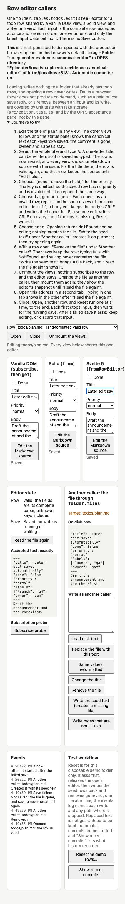
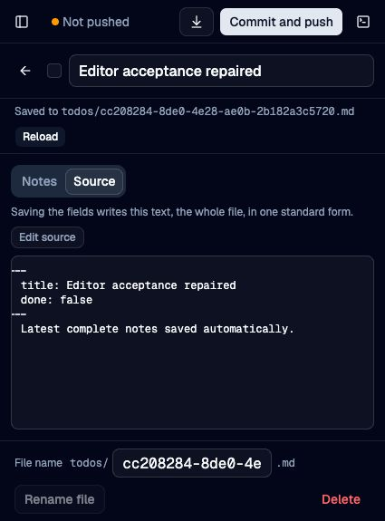
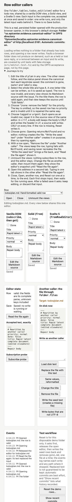

# Continuous row saves: 2026-10-05

The editor owns accepted complete text, one running write promise, and the latest
waiting text. It starts waiting input after either outcome. Without new input,
a failed write stops. Later edits save automatically. `saving.error` keeps the
previous failure visible until a newer write succeeds. `flush()` follows
consecutive writes, including writes accepted by subscribers, and returns the
final relevant outcome.

Structured `set` formats then follows the same interpretation as `setText`.
The public names remain unchanged. Retry is an optional new save of current text.
Browser and native storage carry no cross-writer request numbering. Late and
duplicate native deliveries may land last. File locks, explicit conditions,
replace-only behavior, permissions, and page/session authorization remain.

## Verification

The live combined checkout passed:

- Folder script: 757 logic tests, 18 native tests skipped in that run, and 14
  Svelte tests. Controlled tests cover held writes, latest waiting text,
  failure continuation, visible error retention/clearing, reentrant input,
  flush, malformed text, reload, and deleted rows.
- Real native bridge: all 18 tests, including delayed hashing, independent
  handles, guarded writes, and post-detach refusal.
- Native workspace: 105 core tests and 19 plugin tests; one plugin acceptance
  test and documentation examples remain ignored by their existing scripts.
- Capture, Honeycrisp, Todos, Vocab, and Whispering: 1,161 tests including their
  mounted views. All five app typechecks and the whole workspace typecheck pass.
- Honeycrisp Rust: 59 tests. Both native quit page scripts bundle.
- Bindings regenerated with the owning Rust bindings test; both sides use
  protocol 7 and `apply(session, changes)`.

The first combined run caught remaining protocol-6 assertions, which were
corrected. History source was concurrently integrated during that run; rerunning
against the stable combined checkout passed. The first native bridge run timed
out during competing Cargo builds; its warm rerun passed in 6.8 seconds without
changing test timeouts. No native GUI quit journey is claimed.

## Browser observations

Computer use exercised real Todos at `127.0.0.1:5186` and production browser
folder callers at `localhost:5181`, with disposable local data. The latter shares
one editor among vanilla DOM, Solid, and Svelte views over real OPFS storage.

Before the change, deleting a demo row, typing, recreating the file explicitly,
and typing again left the new input failed and the seed on disk. After the
change, the later edit saved automatically without Retry. All three views showed
Saved, and the on-disk complete document matched accepted text:

Todos field autosave, source preview, malformed-source repair, and Reload were
exercised through the real app:

Malformed source remained editable and saved exactly. Repair restored structured
fields in the same editor. Rapid title typing saved the latest complete document.
Unmounting and remounting retained the editor; an outside file edit did not
silently replace input. Reload adopted that file, and Close followed by Open
showed it:

Ordinary fast browser typing does not prove scheduling races. Held asynchronous
unit and mounted tests provide that evidence. Native protocol and authorization
were exercised through the real Rust bridge, rather than a desktop GUI session.

## Interpretation cost

Apple M4 Max, Bun 1.3.14, 300 edits per benchmark mode. Median milliseconds:

| Document | Structured title before | After | Structured body before | After |
| --- | ---: | ---: | ---: | ---: |
| Small row | 0.036 | 0.050 | 0.031 | 0.041 |
| 200-key header | 1.237 | 2.191 | 1.241 | 2.117 |
| 200 KB body | 0.057 | 0.078 | 0.116 | 0.118 |

The shared path increases work for a large header: title p95 rose from 2.35 to
4.498 ms. These are synchronous interpretation measurements, not storage latency.
The measured cost supports retaining the simpler single path without the
formatter-produced flag.

## Review and ownership

Independent GPT and Claude design reviews preceded implementation. The native
contract checkpoint checked deletion of writer tracking against window/page
registration, locks, and publication conditions. Final independent reviews supported core scheduling, error visibility, actual
app lifecycle callers, and the native contract. Claude found two app defects:
Todos checked unsettled edits before acquiring recovery fences, and Honeycrisp
read its missing-file state without Svelte tracking. A bounded worker moved
Todo recovery checks inside the existing fences and made Honeycrisp read the
tracked editor. The unused Todo hold/reload helper was deleted. Controlled
two-editor recovery and mounted missing-file-button regressions pass; both apps
were rechecked after integration. Both independent reviewers accepted these
repairs with no remaining blocker. A failed post-recovery reread still preserves
the previous editor text; further edits follow the same whole-file
last-landed-wins policy. Recovery fences prevent writes while recovery runs,
without adding a permanent input latch after a read failure. The editor queue and history scheduler own different obligations:
input serialization and a coalesced local history request after confirmed saves.
Git testbed merge work owns repository merge state separately.

No deployment or push was performed. Task-start staged device changes and other
unrelated dirty work remain preserved. Commit preparation selects task deltas;
shared-file scheduler hunks belong to their coordinating chat.
